# Executed baseline architecture

```mermaid
flowchart LR
  D[Recorded video + logged GPS + metadata] --> S0[Ingest + clock alignment]
  S0 --> S1[QA + coverage keyframes]
  S1 --> S2[COLMAP + robust Sim3 + GTSAM]
   S2 --> S6[Global pose graph + joint visual/GNSS BA]
   S6 --> S3[Detector + motion masks + optional semantic maps]
  S3 --> S4[Local depth + metric inverse fitting]
  S6 --> S4
  S4 --> S7[Tiled confidence-filtered point fusion]
  S7 --> S8[Poisson + observed texture atlas]
   S8 --> S9[DSM / DTM / projected orthomosaic]
   S3 --> S9
  S9 --> S10[Real exporters]
  S10 --> R[HTML / JSON report]
  S10 --> API[FastAPI]
  API --> UI[React + offline Cesium / local Potree]
```

The bundle is the sole durable inter-stage interface. S5 live fusion is folded
into S7. S6 precedes S3/S4 so depth alignment uses final poses **and final sparse
structure**. This dependency correction is recorded in the execution plan.

## Stage methods and degradation

| Stage | Actual baseline method | Fallback or failure |
|---|---|---|
| S0 | Single-threaded PyAV PTS decode, strict telemetry adapters, bounded GPS interpolation and optional nearest barometer alignment | Invalid mandatory input fails with report; GPS gaps marked; optional sensor failure preserves GPS |
| S1 | Laplacian/exposure QA, cross-checked ORB image-displacement/coverage heuristic, full-clip selection | All drops logged; unusable footage fails explicitly; image displacement is not geometric parallax |
| S2 | CPU COLMAP self-calibrated SfM, seeded RANSAC Umeyama, visual+GNSS GTSAM pose graph with optional barometer/free-offset factors | Real Sim3 retained if GTSAM unavailable; optional sensor support/clock failures skip factors |
| S6 | GTSAM covisibility pose graph and retriangulation, then joint fixed-calibration reprojection/GNSS BA; optional recorded heights and free bias in both solvers | Joint solve failure/unsupported support retains real pose-graph products and records the reason |
| S3 | Verified local RT-DETR conservative boxes plus motion residuals; optional local semantic logits with explicit class mapping | Classical optical-flow homography/epipolar residuals; unknown frames excluded; semantic failures retain masks and a status descriptor |
| S4 | Verified local Small inverse-depth adapter (Torch or OpenVINO), robust `1/Z=a*p+b` | Unanchored/high-residual maps are explicitly non-metric and excluded |
| S7 | Disk-partitioned, confidence-filtered voxel point fusion, external merge and mmap | Empty viable geometry fails; no fake TSDF/3DGS label |
| S8 | Open3D Poisson with view-oriented normals, support-based flags, observed-image best-view UV atlas | Texture failure retains real mesh and records degraded status |
| S9 | Observed-support DSM, morphological ground separation DTM, camera/DSM-projected imagery and optional categorical semantic rasters | Nodata/alpha retained; geometry-domain/datum errors explicit; optional semantic failures isolated |
| S10 | OBJ/PLY/LAS/GeoTIFF/glTF/GLB, isolated Blender FBX, actual optional tool adapters | Missing/failed formats recorded individually; required gaps degrade |
| Report | Manifest provenance, regional support, independent DSM elevation checks | Partial-safe, absent measurements null, full accuracy UNVALIDATED |

The chosen point-fusion path satisfies the PRD dense-method choice. GTSAM pose
graphs refine relative visual poses and GNSS. S6 additionally optimizes camera
rotations, centers and supported sparse points jointly against measured feature
reprojections and GNSS. Intrinsics remain fixed at the S2 calibration so the
undistorted images and K remain coherent. SAM2/ByteTrack/RAFT learned masking,
feed-forward geometry, 3DGS, learned completion, PDAL SMRF, and IMU preintegration
are not claimed as implemented.

### S6 joint bundle adjustment

The local-origin float64 solve uses sparse finite-difference Jacobian dependencies,
SciPy trust-region/LSMR least squares and component-wise Huber loss after pixel/GNSS
sigma normalization. Recorded GNSS sigmas override typed default assumptions.
The recorded first Sim3 rotation prior closes the weak rotation gauge; a measured
GNSS-to-camera lever arm is still unavailable. Neither GNSS fit nor reprojection
fit establishes independent accuracy.

Track selection respects point and observation limits, prioritizing non-collinear
visual support across cameras and component bridges before ascending-index fill.
This deterministic greedy selection is not an exhaustive feasibility search.
Inferred/single-view/invalid tracks cannot establish optimization support. The
solver must converge within its evaluation budget, decrease or preserve the
robust objective, and leave all selected observations at valid positive depth.
Failure returns unchanged input geometry. After an accepted pose change,
unoptimized sparse points remain stored with zero confidence so they cannot
anchor metric depth; pre-BA pose covariance is removed. Final anchors are always
recomputed from the published pose/point pair.

### Optional recorded-height fusion

S0 parses the configured optional barometer CSV with an explicit clock origin and
bounded nearest-sample association. Registered cameras receive the actual sample
and uncertainty provenance by frame identity. Duplicate/shared raw samples are
not counted as independent factors; inconsistent timestamps or raw provenance
are excluded without suppressing the visual/GNSS baseline.

Both GTSAM and joint SciPy BA can add scalar camera-height residuals and one free
constant sensor-offset variable. GNSS still establishes absolute height and CRS;
barometer heights have no interpreted absolute datum. GTSAM custom-factor
derivatives use its right-local Pose3 tangent. BA appends the nuisance scalar and
sparse dependencies, using central differences for the enabled sensor model.
Existing no-barometer solving behavior remains available with disabled defaults.

Actual attempts and accepted final factor use are recorded separately. Failed
solves retain input geometry with null accepted bias/fit, and inadequate optional
support preserves the baseline solve. Reports identify BA, graph or retained-S2
final provenance, suppressing stale current use. No measured sensor lever arm,
weather-drift model, calibrated uncertainty or absolute sensor accuracy is claimed.

### Optional semantic path

S3 loads a verified local Transformers semantic-logits checkpoint only when
`semantics.model` is configured. Its explicit source-channel mapping produces
uint16 class maps; class 0 and probability 0 mean unknown, below threshold or
dynamic exclusion. The retained probability is the winning source-channel
softmax value, uncalibrated and separate from geometry confidence. Resize-only
processors are supported; crop/pad preprocessing is rejected without an inverse
pixel transform. Model provenance records actual validated frame inference.

S9 consumes S3 as a declared dependency. It samples labels nearest-neighbor through
the final-camera DSM/mesh visibility test, retaining only supported observed cells.
It publishes class/probability GeoTIFFs with CRS/datum/mapping provenance, plus a
bounded nearest-neighbor EPSG:4326 preview. Unsupported/inferred cells remain
nodata. Optional failures leave real mandatory products inspectable.

The API confines and validates the optional descriptor and its file references.
Cesium displays its class legend, original raster download and selectable 2D
ellipsoid imagery; measurement picks continue to use reconstruction geometry.
Reports retain prior semantic provenance with its stage status and suppress stale
current support measurements. Real checkpoint quality and browser scene placement
remain unvalidated.

## Geometry and confidence

Camera axes are right/down/forward. `R_cw` transforms local-world to camera;
`center` is local-world camera center. Metric Z is optical-axis depth, not ray
range. Final undistorted images and K share a domain. Global projected position
is computed in float64; glTF axes/recentering are persisted and inverted by UI.

Observed texture baking ranks multiple valid cameras per face and retries the
next candidate when the preferred view fails mask, visibility, or projected
texel coverage checks. Binary atlas alpha is exported as a glTF mask rather than
blend transparency. Confidence uses observed support, agreement/residuals, texture visibility and
inference flags. It is a proxy, **not calibrated absolute uncertainty**. Stage
records label numeric summaries as `measured_proxy`, or retain `unavailable` with
a reason when no honest numeric summary exists. Conditional
GTSAM covariance records assumed factor-noise provenance. No method gains
confidence because an executable happens to exist.

## Bundle integrity and resume

Input copies and artifact paths are bundle-relative by default. Local checkpoint
cache is a separate prerequisite when transferring. Atomic manifests contain
source hashes, full resolved config, seeds, exact model inventories, actual host
versions, stage measurements/status/errors, output hashes and transform provenance.

`content_id` excludes time/output location. `manifest_sha256` covers the current
execution record including timings. Stage freshness covers source files, code,
config, model inventory, runtime versions, upstream revisions and output integrity.
Changing environment may rerun stages: cross-backend bitwise identity is not
assumed. `verify` certifies recorded integrity; independent rebuild comparison is
needed for determinism.

Failures preserve partial artifacts and an HTML/JSON report. Dependencies are
blocked rather than marked successful. The canonical L0–L6 ladder is recorded as
context; offline faults are expressed by actual named degradation reasons instead
of repurposing the same numeric levels into arbitrary confidence ceilings.
